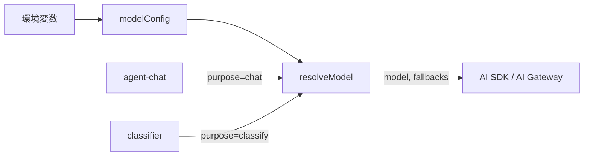

# Spec: llm

目的：各モジュールが、使うモデルを自分で選んで LLM を呼べるようにする。そのための共通の入口を用意する。

Status: Draft（レビュー待ち）

## Objective
- agent-chat と classifier が、モデル ID を指定して LLM を呼べる
- モジュールごとに、どのモデルを使うかを設定で差し替えられる（コードを変えずに済む）
- 呼び出しに失敗したときは、指定した予備のモデルに切り替わる（fallback）
- ストリーミング（チャット用）と、構造化された出力（分類用）の両方を扱える

## Tech Stack
- TypeScript
- `ai`（Vercel AI SDK）: 2026-09-30 時点の最新は 7.0.123
- AI Gateway（`@ai-sdk/gateway`）: 同 4.0.101
- パッケージマネージャ: pnpm 10

## 境界（Input / Output）
| 境界 | 責任 | Input | Output |
|---|---|---|---|
| `resolveModel(purpose)` | 用途名から、使うモデル ID と予備のモデル ID を返す | `purpose: "chat" \| "classify"` | `{ model: string, fallbacks: string[] }` |
| `modelConfig` | 用途とモデルの対応表。環境変数で上書きできる | 環境変数 | `Record<purpose, { model, fallbacks }>` |

- 呼び出しそのもの（`generateText` / `streamText` / `generateObject`）は AI SDK の関数を各モジュールが直接使う。llm モジュールでラップはしない
- 最初から厚みを持たせないため、llm モジュールは「どのモデルを使うか決める」部分だけを持つ



## Commands
フロントのフレームワークが未決定のため、仮のコマンドです。
```
Install: pnpm install
Test:    pnpm test
Lint:    pnpm lint
Type:    pnpm typecheck
```

## Project Structure（仮）
```
src/llm/model-config.ts    → 用途とモデルの対応表
src/llm/resolve-model.ts   → resolveModel
src/llm/*.test.ts          → 単体テスト
```

## Code Style
- 1ファイル1責務で、named export を使う
- API のシグネチャは、実装時に AI SDK の型定義で確認する（記憶で書かない）

## Testing Strategy
- テストランナーは Vitest（案）
- 単体テストで確認すること: 用途ごとの既定モデル、環境変数による上書き、未知の用途を渡したときのエラー
- 実際の LLM 呼び出しはテストでは行わない。疎通は手動で1回確認する

## Boundaries
- Always: API キーは環境変数から読む。テストを通してからコミットする
- Ask first: 依存パッケージの追加。有料モデルを既定値にすること
- Never: API キーをコミットしない。llm モジュールに業務ロジック（分類ルールなど）を入れない

## Success Criteria
- [ ] `resolveModel("chat")` と `resolveModel("classify")` が、既定のモデル ID と予備のモデル ID を返す
- [ ] 環境変数を変えるだけで、コードを変えずに使うモデルを差し替えられる
- [ ] 未知の用途を渡すとエラーになる
- [ ] AI Gateway 経由で、既定モデルへの疎通を1回確認できる（手動）

## Open Questions
- 既定のモデル（chat 用、classify 用）をどれにするか
- AI Gateway の無料枠で足りるか。足りなければ、自分のキーを持ち込む方式（BYOK）にするか
- テストランナーとフレームワーク（Next.js にするか）
